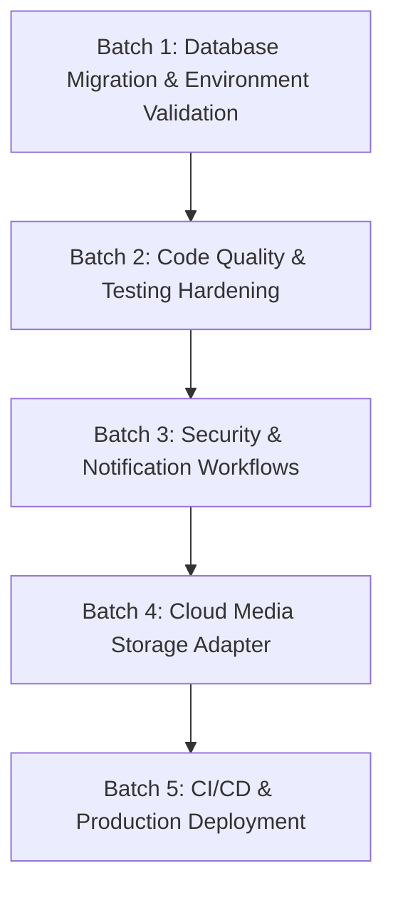

# MRM InfoTech Backend: Master Production Implementation Plan

**Project:** MRM InfoTech Official Corporate Website Backend  
**Date:** October 31, 2026  
**Auditor Roles:** Senior Software Architect, Principal Backend Engineer, Security Engineer, DevOps Engineer  
**Reference Documents:**
- [`MRM_COMPLETE_BACKEND_PRODUCTION_READINESS_AUDIT.md`](file:///d:/MRM/MRM_Backend/MRM_COMPLETE_BACKEND_PRODUCTION_READINESS_AUDIT.md)
- [`MRM_PRODUCTION_BLOCKERS_AND_PRIORITIZED_ROADMAP.md`](file:///d:/MRM/MRM_Backend/MRM_PRODUCTION_BLOCKERS_AND_PRIORITIZED_ROADMAP.md)

---

## 1. Plan Overview & Principles

This master plan groups all required engineering tasks into **5 coherent, sequential implementation batches**. Each batch has well-defined scope boundaries, strict testing requirements, and concrete acceptance criteria.

### Guiding Principles:
1. **Zero Downtime / Zero Data Loss:** Database changes must be backward-compatible and tested against disposable databases before production execution.
2. **Fail-Closed Security:** Security guarantees and permission boundaries must never be relaxed or bypassed during implementation.
3. **Evidence-Based Acceptance:** Every batch requires verifiable automated test output before it is declared complete.

---

## 2. Implementation Batch Roadmap

---

## 3. Detailed Batch Specifications

### BATCH 1: Database Migration & Environment Validation (P0)

- **Objective:** Provision an isolated PostgreSQL instance, execute the initial migration, apply SQL constraints, verify database seed, and conduct live smoke tests.
- **Scope:**
  - Setup local or remote disposable PostgreSQL 16+ database.
  - Run `npx prisma migrate deploy` targeting the disposable instance.
  - Apply `prisma/sql/constraints.sql` for custom check constraints and partial indexes.
  - Execute `npm run prisma:seed` and verify default administrator user and RBAC permissions.
  - Execute live database connectivity smoke test.
- **Expected Files Affected:**
  - `docker-compose.yml` (if adjusting container ports or healthcheck)
  - `.env` (pointing `DATABASE_URL` to the test database)
- **Testing Requirements:**
  - `npx prisma migrate status` must report schema is fully in sync.
  - Query PostgreSQL `information_schema.tables` to confirm 63 tables exist.
  - Query `users` and `roles` to verify seed data exists.
- **Definition of Done (DoD):** Database schema and seed data are verified functional against a real PostgreSQL instance with zero errors.

---

### BATCH 2: Code Quality & Testing Hardening (P1)

- **Objective:** Align code formatting, ensure automatic Prisma Client generation on fresh installs, and repair nested module E2E tests.
- **Scope:**
  - Run `npm run format` and commit formatting across all 188 files in an isolated commit.
  - Update `package.json` scripts:
    - `"build": "prisma generate && nest build"`
    - `"pretest": "prisma generate"`
  - Standardize nested E2E test suites (`blog.e2e-spec.ts`, `faqs.e2e-spec.ts`, `products.e2e-spec.ts`, `testimonials.e2e-spec.ts`) using shared `FakePrismaService` mocks.
  - Update or create a Jest E2E configuration to execute all 7 E2E suites cleanly.
- **Expected Files Affected:**
  - `package.json`
  - All source files modified by Prettier
  - `src/modules/*/test/*.e2e-spec.ts`
  - `test/jest-e2e.json`
- **Testing Requirements:**
  - `npm run format:check` must pass (exit code 0).
  - `npm run typecheck` and `npm run lint` must pass (exit code 0).
  - `npm test` and `npm run test:e2e` must pass 100% of tests.
- **Definition of Done (DoD):** Clean repository formatting and complete test suite passes out of the box without manual workarounds.

---

### BATCH 3: Core Security & Notification Workflows (P0 / P1)

- **Objective:** Fix the 2FA lockout condition and implement transactional email dispatch for contact inquiries and leads.
- **Scope:**
  - Fix `AuthService.login()`:
    - Safely disable or gracefully handle 2FA flag until full TOTP verification flow is enabled, preventing admin lockout.
  - Implement `MailService` using `@nestjs-modules/mailer` or Nodemailer:
    - Dispatch sales team alert when `POST /contact/inquiries` or `POST /contact/leads` is received.
    - Dispatch confirmation acknowledgment to customer.
    - Implement graceful failure handling (mail failure does not abort lead creation).
- **Expected Files Affected:**
  - `src/modules/auth/auth.service.ts`
  - `src/modules/auth/auth.controller.ts`
  - `src/modules/contact/contact.service.ts`
  - `src/common/services/mail.service.ts` (new)
- **Testing Requirements:**
  - Unit tests for `AuthService` covering 2FA handling.
  - Unit tests for `ContactService` asserting email dispatch events.
- **Definition of Done (DoD):** Administrative authentication is secure and free of lockout defects; lead inquiries reliably trigger asynchronous email notifications.

---

### BATCH 4: Cloud Media Storage Adapter (P2)

- **Objective:** Implement cloud object storage (Cloudflare R2 or AWS S3) for media assets instead of ephemeral local disk buffers.
- **Scope:**
  - Create `StorageService` interface and S3-compatible provider implementation (`@aws-sdk/client-s3`).
  - Wire `MediaService` to upload buffers directly to cloud storage and store public CDN URLs in `MediaAsset` records.
  - Implement presigned URL generation for secure, direct-to-cloud administrative uploads.
- **Expected Files Affected:**
  - `src/modules/media/media.service.ts`
  - `src/common/storage/storage.service.ts` (new)
  - `.env.example` (add `S3_ENDPOINT`, `S3_BUCKET`, `S3_ACCESS_KEY`, `S3_SECRET_KEY`)
- **Testing Requirements:**
  - Unit tests with mocked S3 client for upload, stream, and delete methods.
- **Definition of Done (DoD):** Uploaded assets persist reliably to external cloud storage and stream properly in production.

---

### BATCH 5: Production Deployment & CI/CD Pipeline (P1 / P2)

- **Objective:** Automate quality gates via GitHub Actions and prepare a production Docker container.
- **Scope:**
  - Create `.github/workflows/ci.yml` running lint, format check, typecheck, tests, and build.
  - Create multi-stage production `Dockerfile` with minimal Alpine/Debian node image and non-root execution.
  - Document deployment steps, environment configuration, database backup/recovery runbooks in `README.md`.
- **Expected Files Affected:**
  - `.github/workflows/ci.yml` (new)
  - `Dockerfile` (new)
  - `.dockerignore` (new)
  - `README.md`
- **Testing Requirements:**
  - Verify container builds cleanly with `docker build -t mrm-backend:latest .`
  - CI pipeline passes green on pull request.
- **Definition of Done (DoD):** Backend is fully containerized, automated CI runs on every commit, and deployment documentation is complete.

---

## 4. Final Production Readiness Criteria

The backend will be officially certified for production launch when:

1. [ ] **PostgreSQL Migration Applied:** Migration `20261030194410_init` applied cleanly to production database.
2. [ ] **Zero Compilation & Lint Errors:** `tsc --noEmit` and `eslint` pass with exit code 0.
3. [ ] **Formatting Aligned:** `prettier --check` passes with exit code 0.
4. [ ] **Automated Test Coverage:** 100% of unit tests (182+ tests) and all E2E suites pass.
5. [ ] **Security Verified:** 2FA lockout resolved, CSRF origin checks verified, rate limiting active.
6. [ ] **Notifications Operational:** Sales inquiry notifications and customer confirmations dispatch successfully.
7. [ ] **Container & CI Operational:** Production container image built; GitHub Actions workflow passing.

---
*End of Master Production Implementation Plan.*

